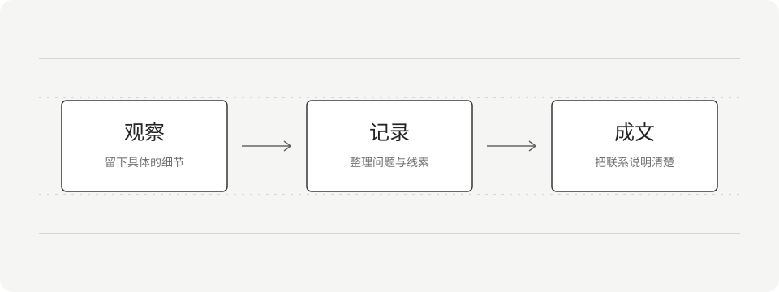

+++
title = "Markdown 排版示例"
date = 2026-10-26T10:00:00+08:00
slug = "markdown-guide"
description = "一篇用于检查中文长文、标题层级、列表、表格、引用、代码与本地图片效果的排版示例。"
summary = "这是一篇中文排版示例，包含标题、列表、表格、引用、代码和图片，可以用来检查文章页的阅读效果。"
tags = ["示例", "写作"]
draft = false
+++

这是一篇中文排版示例，用来检查长文的阅读效果。正文包含常用的标题、列表、表格、引用、代码与本地图片，方便确认不同内容在桌面和手机上的呈现。

## 让文字有清楚的层次

一篇文章通常围绕一个主题展开。开头交代背景，主体说明问题，结尾留下结果或仍待解决的疑问。段落之间留出适当的空白，可以让阅读更轻松。

**加粗文字**适合提示关键结论，*强调文字*可以表达语气变化。行内代码如 `draft = false` 用来呈现配置项、变量名或其他需要精确区分的文字。

### 标题服务于内容

二级标题可以划分主要部分，三级标题补充其中的具体问题。同一层级尽量采用相近的表达方式，读者浏览目录时就能预先理解文章的结构。

下面这段较长的文字用于检查中文换行与行距：在整理一个尚未成形的想法时，先把观察到的事实写下来，再说明自己的解释，最后补充仍然不确定的地方。读者不需要从第一句就接受结论，但应该能够看清每一步之间的联系。文章的节奏来自这些具体的连接，也来自必要的停顿。

## 列表与步骤

并列的信息适合使用无序列表：

- 标题概括文章要讨论的具体问题。
- 摘要帮助读者判断是否继续阅读。
- 标签提供另一条查找相关文章的路径。

有先后关系的操作则适合使用有序列表：

1. 写下问题和已知信息。
2. 整理过程，补上必要的例子。
3. 通读全文，删去重复和含糊的表达。

### 引用与补充

> 这是一段用于检查引用样式的示例文字。引用框可以呈现需要单独阅读的说明；正式引用他人的原话时，应注明来源。

段落回到正文后，视觉层级也应恢复自然。引用不必很长，能够保留完整语义即可。

## 用表格比较信息

| 内容形式 | 适合记录什么 | 阅读时关注什么 |
| --- | --- | --- |
| 随笔 | 一个观察或想法 | 表达是否清楚 |
| 实践记录 | 问题、尝试和结果 | 过程能否被理解 |
| 阅读笔记 | 观点、出处和疑问 | 原文与转述是否区分 |

表格更适合比较相同维度的信息。如果单元格里放进了很长的解释，拆回段落通常会更容易阅读。

## 代码与说明

下面的 JavaScript 片段仅用于展示语法高亮、缩进和代码复制效果：

```javascript
const notes = [
  { title: "第一篇文章", draft: false },
  { title: "尚在整理的想法", draft: true },
];

const publishedTitles = notes
  .filter((note) => !note.draft)
  .map((note) => note.title);

console.log(publishedTitles);
```

代码前后可以分别交代用途与结果。对于较长的代码，只保留与当前问题有关的部分，能让读者更快找到重点。

## 图片与文字相互补充

下图是一张随文章保存的本地 SVG，展示从观察到成文的简单过程。



### 为图片写一段说明

图片的替代文字应概括它传达的信息，而不只是写“图片”。如果图片承载了重要结论，正文也可以补充说明，让无法看到图片的读者仍能理解文章。

## 发布前再读一遍

完成初稿后，可以最后检查一次标题是否准确、链接是否可用、图片是否有替代文字，以及示例是否足够说明问题。当前整篇文章都是初始化示例，后续可以直接替换为你的内容。
